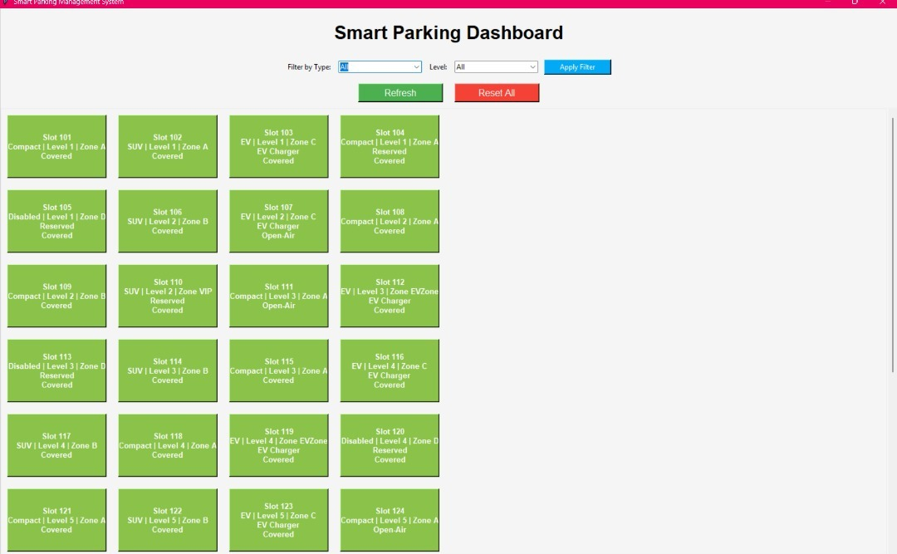
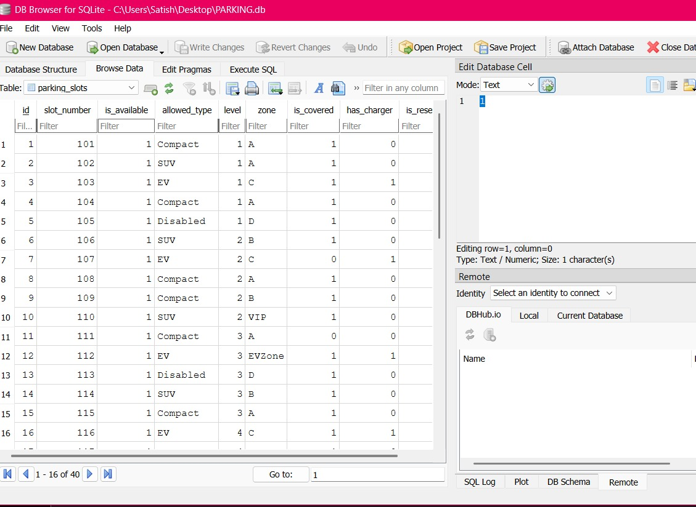

# Smart Parking Management System

Group project for **TPD3363 Object-Oriented Programming**, UPNM (June 2025).

A desktop app that shows parking slots on a dashboard, filters them by vehicle type and level, and lets you book a slot with one click. Slot data is stored in SQLite, so bookings persist between runs.



## Features

- **Tkinter dashboard:** each slot is a button showing type, level, zone, covered/open-air, EV charger and reserved status
- **Colour-coded:** green = available, pink = booked
- **Filters:** by vehicle type (Compact, SUV, EV) and by level
- **Booking:** click a slot to book it; booked slots can't be double-booked
- **Reset All:** frees every slot after a confirmation prompt
- **SQLite database:** the `parking_slots` table is created and seeded automatically on first run



## Database design

| Field | Type | Description |
|---|---|---|
| id | INTEGER | Primary key |
| slot_number | INTEGER | Unique slot number |
| is_available | INTEGER | 1 = available, 0 = occupied |
| allowed_type | TEXT | Compact / SUV / EV |
| level | INTEGER | Floor |
| zone | TEXT | Section (A, B, C...) |
| is_covered | INTEGER | 1 = covered, 0 = open-air |
| has_charger | INTEGER | 1 = EV charger |
| is_reserved | INTEGER | 1 = reserved |

## Files

| File | What it is |
|---|---|
| `cars.py` | Final version: dashboard with filters, scrolling and Reset All |
| `parking_v1.py` | Earlier version: simple grid with booking and reset |
| `PARKING.db` | The team's slot data (Compact, SUV, EV, Disabled; zones A–D, VIP, EV Zone) |

## Run it

```bash
python cars.py
```

No extra packages are needed. The app uses `PARKING.db` if it's in the folder; otherwise it creates and seeds a new one.

## Future ideas

Sensors for real-time occupancy, a mobile app, RFID check-in, a cloud database and timer-based billing.

## Team

Satish Sargunan, Magendren Parthiban, Mahesh Sivakandan, Yuvanash Saravanan
